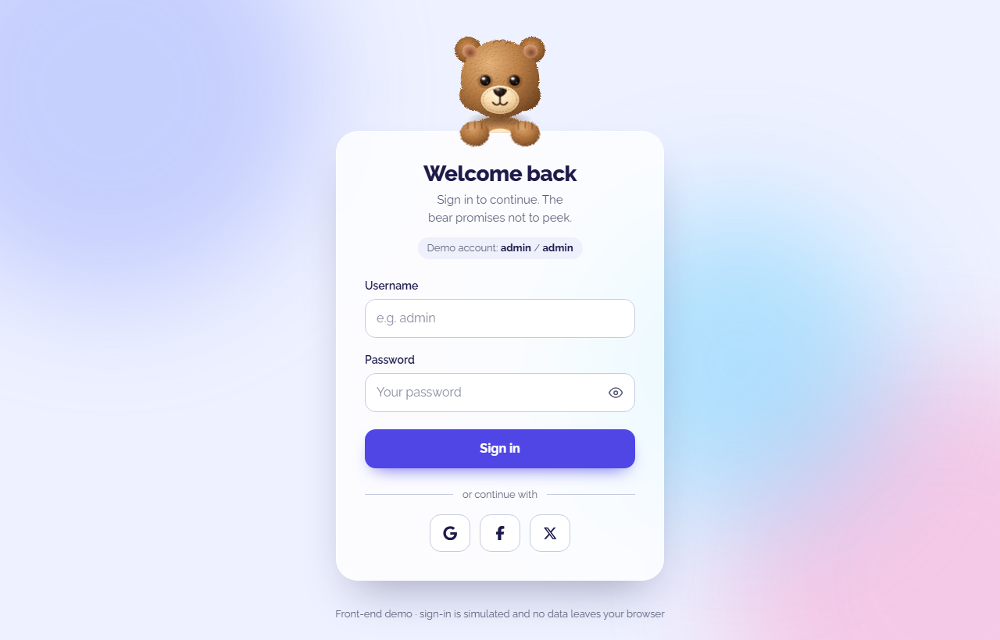

# Animating Login Form

A playful, accessible login form where a friendly bear follows your typing and covers its eyes while you enter your password.




> **Demo only:** there is no backend. Sign-in is simulated in the browser. Use **`admin` / `admin`** to see the success state.

## Features

- **Reactive mascot.** A pure SVG + CSS plush teddy bear (lit fur texture, button eyes, embroidered nose) that:
  - follows the caret with its eyes while you type your username
  - raises its arms from behind the card to cover its eyes for the password, and peeks when you show it
  - looks thoughtful while "signing in", cheers on success and shakes its head on a wrong password
- **Client-side validation** with clear inline messages, live re-checking once a field shows an error, and focus moved to the first invalid field.
- **Show/hide password** toggle that keeps focus in the input.
- **Loading and success states** for the simulated request, including a spinner, an error alert and a sign-out flow.
- **Accessible by design.** Real labels, `aria-invalid` / `aria-describedby`, live regions, visible focus rings and full keyboard support.
- **Respects `prefers-reduced-motion`** and **light/dark color schemes** automatically.
- **Responsive** down to 360px wide.
- **Small and fast.** No UI framework and no animation runtime: the bear is plain SVG animated with CSS transitions.

## Tech stack

| Area    | Tools                                             |
| ------- | ------------------------------------------------- |
| UI      | React 19, CSS Modules, custom properties          |
| Build   | Vite 8                                            |
| Testing | Vitest, Testing Library, jsdom                    |
| Quality | ESLint (flat config, React Hooks rules), Prettier |
| Assets  | `react-icons`, self-hosted Raleway via Fontsource |

## Getting started

Requires **Node.js 22.12 or newer**.

```bash
npm install        # install dependencies
npm run dev        # start the dev server at http://localhost:5173
npm run build      # production build in dist/
npm run preview    # serve the production build locally
npm test           # run the test suite once (npm run test:watch to watch)
npm run lint       # lint with ESLint
npm run format     # format with Prettier
```

## Project structure

```
animating-login-form/
├── docs/screenshot.png
├── public/favicon.svg
├── src/
│   ├── components/
│   │   ├── FormField/        # labelled input with error message + trailing slot
│   │   ├── LoginForm/        # card, form logic wiring, success view, tests
│   │   ├── Mascot/           # animated SVG bear and its moods
│   │   ├── PasswordToggle/   # show/hide password button
│   │   └── SocialLogin/      # social sign-in buttons (demo)
│   ├── hooks/useLoginForm.js # values, errors and submit lifecycle
│   ├── services/fakeAuth.js  # simulated authentication (no backend)
│   ├── utils/validateLogin.js
│   ├── styles/global.css     # design tokens, dark mode, reduced motion
│   ├── test/setup.js
│   ├── App.jsx
│   └── main.jsx
├── index.html
├── vite.config.js
└── eslint.config.js
```

## How the animation works

`LoginForm` derives a **mood** (`idle`, `watching`, `shy`, `peek`, `thinking`, `happy`, `sad`) from the focused field, the password visibility and the submit status. `Mascot` applies the mood as a CSS class. It also passes a `--gaze` custom property (0–1, based on the username length), which CSS turns into pupil movement and a head tilt. All motion is driven by CSS transitions and keyframes.

## Author

**Pasindu Sandamal** · [GitHub](https://github.com/<your-username>)
